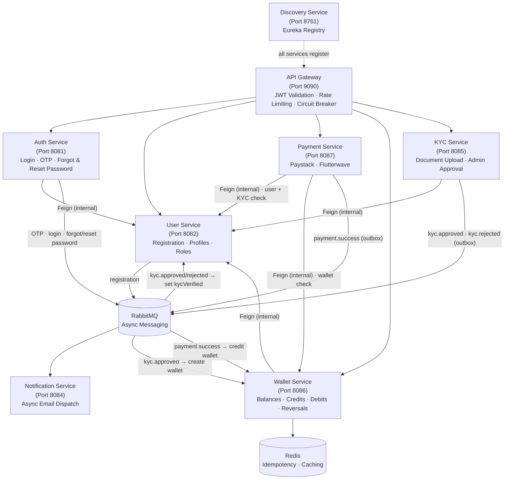

# GatePay — Microservices Payment Gateway

GatePay is a payment gateway built on a microservices architecture using
Java 17, Spring Boot 3, and Spring Cloud. It covers the full lifecycle of a
payment platform — user onboarding, JWT authentication with OTP, KYC
verification with document uploads, payments through Paystack and
Flutterwave, event-driven wallets, and async email notifications — across
8 independently deployable services orchestrated via Docker Compose.

The interesting parts are the ones that deal with money and consistency:
payment and KYC events go through a transactional outbox so they can't be
lost, wallet credits are idempotent at the database level, concurrent
balance updates use optimistic locking with retries, and every user-scoped
endpoint checks that the caller owns the data.

---

## Architecture



---

## Services

| Service | Port | Responsibility |
|---|---|---|
| `discovery-service` | 8761 | Eureka registry — every service registers here on startup |
| `gateway-service` | 9090 | Single entry point — routing, JWT validation, rate limiting, and circuit breaking |
| `auth-service` | 8081 | Issues and validates JWTs, handles OTP flows, login, and password reset |
| `user-service` | 8082 | User registration, profile management, and role assignment |
| `payment-service` | 8087 | Processes payments via Paystack and Flutterwave through pluggable provider strategies |
| `wallet-service` | 8086 | Manages user wallets — balances, credits, debits, reversals, and transaction history |
| `kyc-service` | 8085 | Document uploads via Cloudinary and admin KYC approval workflows |
| `notification-service` | 8084 | Consumes RabbitMQ events and dispatches transactional emails |

---

## Tech Stack

| Category | Technology |
|---|---|
| Language | Java 17 |
| Framework | Spring Boot 3, Spring Cloud |
| Service Discovery | Eureka (Netflix) |
| API Gateway | Spring Cloud Gateway |
| Messaging | RabbitMQ |
| Caching | Redis |
| Database | MySQL (isolated DB per service) |
| Migrations | Flyway |
| Authentication | JWT — access and refresh tokens |
| Resilience | Resilience4j — Circuit Breaker, Feign fallbacks |
| Payment Providers | Paystack, Flutterwave |
| File Storage | Cloudinary |
| API Documentation | Swagger / OpenAPI 3 |
| Distributed Tracing | Zipkin |
| Containerization | Docker, Docker Compose |

---

## Getting Started

### Prerequisites

- Docker and Docker Compose
- Java 17+
- Maven 3.9+

### 1. Clone the repository

```bash
git clone https://github.com/benard1991/gate-pay.git
cd gate-pay
```

### 2. Configure environment variables

Each service ships with a `.env.example`. Copy and fill in your credentials:

```bash
cp .env.example .env
cp auth-service/.env.example auth-service/.env
cp user-service/.env.example user-service/.env
cp payment-service/.env.example payment-service/.env
cp wallet-service/.env.example wallet-service/.env
cp kyc-service/.env.example kyc-service/.env
cp notification-service/.env.example notification-service/.env
cp gateway-service/.env.example gateway-service/.env
```

Two settings worth knowing about for local work:

- `BOOTSTRAP_ADMIN_EMAILS` in `user-service/.env` — comma-separated emails that get the ADMIN role when they register. Registration never takes roles from the request, so this is the only way to create the first admin.
- `EXPOSE_OTP_IN_RESPONSE` in `auth-service/.env` — set to `true` locally to get the login/reset OTP back in the API response instead of checking your email. Leave it `false` anywhere real.

### 3. Enable Docker BuildKit

```bash
export DOCKER_BUILDKIT=1
export COMPOSE_DOCKER_CLI_BUILD=1
```

BuildKit caches Maven dependencies between builds. Without it, all services re-download their dependencies on every build — which can take 20–30 minutes. With it, subsequent builds are significantly faster.

### 4. Build and start all services

```bash
docker compose up --build
```

To run in the background:

```bash
docker compose up --build -d
```

The discovery service starts first. All other services register with Eureka before accepting traffic.

### 5. Service URLs

| Service | URL |
|---|---|
| Eureka Dashboard | http://localhost:8761 |
| API Gateway | http://localhost:9090 |
| Auth Service | http://localhost:8081 |
| User Service | http://localhost:8082 |
| Payment Service | http://localhost:8087 |
| Wallet Service | http://localhost:8086 |
| KYC Service | http://localhost:8085 |
| Notification Service | http://localhost:8084 |
| RabbitMQ Dashboard | http://localhost:15672 |
| Zipkin Tracing UI | http://localhost:9411 |

---

## API Documentation (Swagger)

Each service exposes its own interactive API documentation via Swagger UI. All endpoints can be explored and tested directly from the browser — no Postman required.

| Service | Swagger UI | OpenAPI JSON |
|---|---|---|
| Auth Service | http://localhost:8081/swagger-ui.html | http://localhost:8081/api-docs |
| User Service | http://localhost:8082/swagger-ui.html | http://localhost:8082/api-docs |
| Payment Service | http://localhost:8087/swagger-ui.html | http://localhost:8087/api-docs |
| Wallet Service | http://localhost:8086/swagger-ui.html | http://localhost:8086/api-docs |
| KYC Service | http://localhost:8085/swagger-ui.html | http://localhost:8085/api-docs |
| Notification Service | http://localhost:8084/swagger-ui.html | http://localhost:8084/api-docs |

> **Note:** Use the gateway (port 9090) for anything that needs a logged-in user. Login is two steps: `POST /api/v1/auth/initiateLogin` sends an OTP, then `POST /api/v1/auth/verify-otp` returns the access token. Send it as `Authorization: Bearer <token>`.
>
> The gateway is also what tells each service who the caller is (it sets `X-User-Id` from the token). Calling a service directly on its own port skips that, so user-scoped endpoints like `/wallets/{userId}` return 403 there. The per-service Swagger pages are fine for browsing the API.

---

## Wallet Service

The wallet service manages per-user wallets and all money movement across the platform. It is fully event-driven — wallets are created automatically when KYC is approved, and credited automatically when a payment is verified.

### Wallet Lifecycle

```
User registers
      ↓
User submits KYC documents
      ↓
Admin approves KYC
      ↓
kyc-service saves the decision + a KYC_APPROVED event (outbox)
      ↓
outbox relay publishes it to RabbitMQ
      ↓
user-service marks the user KYC-verified, wallet-service auto-creates the wallet
      ↓
User gets email — "Your wallet is ready"
      ↓
User makes payment via payment-service (wallet checked first)
      ↓
payment-service saves PAYMENT_SUCCESS to its outbox, relay publishes it
      ↓
wallet-service auto-credits wallet
      ↓
User gets email — "Your wallet has been credited ₦X"
```

### Wallet API Endpoints

#### User Endpoints — `ROLE_USER`

| Method | Endpoint | Description |
|---|---|---|
| `GET` | `/api/v1/wallets/{userId}` | Get wallet balance |
| `POST` | `/api/v1/wallets/debit` | Debit wallet |
| `GET` | `/api/v1/wallets/{userId}/transactions` | Get paginated transaction history |
| `GET` | `/api/v1/wallets/transactions/{reference}` | Get transaction by reference |

#### Admin Endpoints — `ROLE_ADMIN`

| Method | Endpoint | Description |
|---|---|---|
| `POST` | `/api/v1/wallets/admin` | Manually create wallet |
| `GET` | `/api/v1/wallets/admin/{userId}` | Get any user's wallet |
| `POST` | `/api/v1/wallets/admin/credit` | Credit a wallet |
| `POST` | `/api/v1/wallets/admin/reverse/{reference}` | Reverse a transaction |
| `PATCH` | `/api/v1/wallets/admin/{userId}/suspend` | Suspend a wallet |
| `PATCH` | `/api/v1/wallets/admin/{userId}/reactivate` | Reactivate a wallet |
| `PATCH` | `/api/v1/wallets/admin/{userId}/close` | Close a wallet |
| `GET` | `/api/v1/wallets/admin/{userId}/transactions` | Get any user's transactions |

### Transaction Filters

The transaction history endpoint supports the following query parameters:

| Parameter | Type | Description |
|---|---|---|
| `type` | `CREDIT / DEBIT` | Filter by transaction type |
| `source` | `TOPUP / COMMISSION / TRANSFER / REVERSAL / REFUND / WITHDRAWAL` | Filter by source |
| `status` | `PENDING / SUCCESS / FAILED / REVERSED` | Filter by status |
| `from` | `LocalDateTime` | Start date filter |
| `to` | `LocalDateTime` | End date filter |
| `page` | `int` | Page number (default: 0) |
| `size` | `int` | Page size (default: 20) |

### Industrial Standards Applied

| Standard | Implementation |
|---|---|
| **Idempotency** | Every credit and debit needs an `idempotencyKey`. A unique key on `(wallet_id, idempotency_key)` in MySQL is what actually stops a double credit; Redis caches the response so repeats are cheap. The cache is only written after the database commit |
| **Optimistic Locking** | `@Version` on the `Wallet` entity. When two updates collide the loser retries on a fresh read (up to 3 times), then gets a 409 |
| **Balance audit trail** | Every transaction records `balanceBefore` and `balanceAfter` |
| **Dead Letter Queues** | The event queues wallet-service consumes have DLQs, so a message that keeps failing is parked rather than dropped |
| **Event-driven** | Wallet creation and credits are triggered by RabbitMQ events — no tight coupling to KYC or payment services |
| **Separation of concerns** | Admin and user endpoints are in separate controllers |

### RabbitMQ Events

| Event | Publisher | Consumer | Action |
|---|---|---|---|
| `kyc.approved` | kyc-service (outbox) | wallet-service | Auto-create wallet (safe if delivered twice) |
| `kyc.approved` / `kyc.rejected` | kyc-service (outbox) | user-service | Set `kycVerified` |
| `payment.success` | payment-service (outbox) | wallet-service | Auto-credit wallet |
| `wallet.credit` | wallet-service | — | Internal audit |
| `wallet.debit` | wallet-service | — | Internal audit |
| `wallet.reversal` | wallet-service | — | Internal audit |
| `wallet.created` | wallet-service | notification-service | Send email |
| `wallet.suspended` | wallet-service | notification-service | Send email |

---

## Distributed Tracing (Zipkin)

GatePay uses [Zipkin](https://zipkin.io) for distributed tracing. Every request that flows through the system — from the API Gateway through to downstream services — is automatically traced and recorded.

**Zipkin UI:** http://localhost:9411

### How to use it

1. Start all services with `docker compose up -d`
2. Make any API call through the gateway (e.g. login, register, initiate payment)
3. Open http://localhost:9411 in your browser
4. Click **Run Query** to see the latest traces
5. Click any trace to see the full request journey across services — including which service was called, in what order, and how long each hop took

### What you can trace

- End-to-end request flows across multiple services
- Latency breakdown per service
- Failed spans and error details
- Inter-service Feign client calls
- RabbitMQ message publishing latency

Zipkin sampling is set to **100%** in development (`probability: 1.0`) so every request is captured.

---

## Useful Commands

```bash
# Stop all services
docker compose down

# Stop and remove all data volumes
docker compose down -v

# Rebuild and restart a single service
docker compose build wallet-service && docker compose up -d wallet-service

# Tail logs for a specific service
docker compose logs -f wallet-service

# Check health status of all services
docker compose ps

# Connect to wallet MySQL database
mysql -h 127.0.0.1 -P 3310 -u root -p gatepay_wallet_service
```

---

## Testing

### Run all tests across all services

From the project root, run:

```bash
mvn clean test
```

This executes tests for every module in one shot. Before running integration tests, make sure Docker is running — Testcontainers will spin up the required containers automatically.

### Run tests for a specific service

```bash
mvn clean test -pl auth-service
mvn clean test -pl user-service
mvn clean test -pl payment-service
mvn clean test -pl wallet-service
mvn clean test -pl kyc-service
mvn clean test -pl notification-service
```

### Run a specific test class

```bash
mvn clean test -pl auth-service -Dtest=OtpServiceImplIntegrationTest
mvn clean test -pl user-service -Dtest=UserRepositoryIntegrationTest
mvn clean test -pl user-service -Dtest=AdminRepositoryIntegrationTest
mvn clean test -pl user-service -Dtest=OtpServiceIntegrationTest
mvn clean test -pl user-service -Dtest=UserNotificationProducerIntegrationTest
mvn clean test -pl kyc-service -Dtest=KycNotificationProducerIntegrationTest
mvn clean test -pl kyc-service -Dtest=KycRepositoryIntegrationTest
mvn clean test -pl payment-service -Dtest=PaymentTransactionRepositoryIntegrationTest
mvn clean test -pl payment-service -Dtest=PaymentRepositoryIntegrationTest
mvn clean test -pl payment-service -Dtest=PaymentEventProducerIntegrationTest
mvn clean test -pl wallet-service -Dtest=IdempotencyServiceImplIntegrationTest
mvn clean test -pl wallet-service -Dtest=TransactionServiceImplTest
mvn clean test -pl notification-service -Dtest=NotificationHandlerServiceTest
mvn clean test -pl notification-service -Dtest=NotificationListenerIntegrationTest
mvn clean test -pl notification-service -Dtest=EmailStrategyTest
```

### Test coverage status

| Service | Status |
|---|---|
| `auth-service` | Unit and integration tests |
| `user-service` | Unit and integration tests, including ownership checks |
| `kyc-service` | Unit and integration tests, including the outbox |
| `payment-service` | Unit and integration tests, including the outbox and wallet check |
| `wallet-service` | Unit and integration tests, including idempotency and lock retries |
| `notification-service` | Unit and integration tests |
| `gateway-service` | No unit tests yet — the JWT filter and access rules were checked end to end against the running stack |
| `discovery-service` | No custom logic to test |

Known issues: `PaymentEventProducerIntegrationTest` and `WalletRepositoryIntegrationTest` can fail when the whole suite runs in one JVM (they share Testcontainers state with other classes) but pass on their own. On a machine with little memory, run integration test classes one at a time.

---

### User Service — Test Coverage

The user-service has full unit and integration test coverage across all layers. Integration tests use [Testcontainers](https://testcontainers.com) to spin up real Docker containers — no mocks, no in-memory databases.

#### Integration Tests

| Test Class | Infrastructure | What It Covers |
|---|---|---|
| `OtpServiceIntegrationTest` | Real Redis + Real MySQL | OTP generation, storage with TTL, verification, deletion, and replay prevention |
| `UserRepositoryIntegrationTest` | Real MySQL + Flyway | Email lookup, eager role loading, phone existence check, and password update with cache invalidation |
| `AdminRepositoryIntegrationTest` | Real MySQL + Flyway | Case-insensitive email lookup, eager role loading by id, paginated user listing, and full-text keyword search across name, email, and phone |
| `UserNotificationProducerIntegrationTest` | Real RabbitMQ + Real MySQL | Message publishing to the correct exchange and routing key, payload validation for OTP email and password reset email |

#### How integration tests work

Every integration test class spins up its own isolated Docker containers via Testcontainers. There is no shared state between test runs — containers start fresh, Flyway runs all migrations against a clean database, and Redis and RabbitMQ are empty before each test class executes.

```
Test starts
    ↓
Testcontainers pulls and starts Docker containers (mysql:8.0, redis:7-alpine, rabbitmq:3.13-management-alpine)
    ↓
@DynamicPropertySource overrides Spring datasource and broker config with container ports
    ↓
Flyway runs all migrations against the fresh MySQL container
    ↓
Spring context starts with real infrastructure
    ↓
Tests run against real databases and real message broker
    ↓
Containers are stopped and removed automatically after the test run
```

> **Note:** Integration tests require Docker to be running. The first run will pull the required images (`mysql:8.0`, `redis:7-alpine`, `rabbitmq:3.13-management-alpine`). Subsequent runs are significantly faster since the images are cached locally.

#### Unit Tests

| Test Class | What It Covers |
|---|---|
| `UserServiceImplTest` | Registration, profile updates, role assignment, and error handling — all dependencies mocked |
| `AdminServiceImplTest` | User search, pagination, status management, and admin operations — all dependencies mocked |
| `UserControllerTest` | HTTP request/response contracts, input validation, and status codes via MockMvc |
| `AdminControllerTest` | Admin endpoint contracts, pagination responses, and access control via MockMvc |

---

### KYC Service — Test Coverage

The kyc-service has full unit and integration test coverage across all layers. Integration tests use [Testcontainers](https://testcontainers.com) to spin up real Docker containers — no mocks, no in-memory databases.

#### Integration Tests

| Test Class | Infrastructure | What It Covers |
|---|---|---|
| `KycNotificationProducerIntegrationTest` | Real RabbitMQ + Real MySQL + Real Redis | Message publishing to `notification-exchange` with correct routing key, KYC approved event publishing to `kyc.exchange`, JSON payload structure validation for both notification and approved event messages |
| `KycRepositoryIntegrationTest` | Real MySQL + Flyway | KYC record persistence, status transitions, lookup by userId, and admin query filters |

#### How integration tests work

Every integration test class spins up its own isolated Docker containers via Testcontainers. There is no shared state between test runs — containers start fresh, Flyway runs all migrations against a clean database, and Redis and RabbitMQ are empty before each test class executes.

```
Test starts
    ↓
Testcontainers pulls and starts Docker containers (mysql:8.0, redis:7-alpine, rabbitmq:3.13-management-alpine)
    ↓
@DynamicPropertySource overrides Spring datasource and broker config with container ports
    ↓
TestRabbitConfig declares notification-exchange (DirectExchange) and kyc.exchange (TopicExchange)
and binds the test queue to both so published messages are capturable
    ↓
Flyway runs all migrations against the fresh MySQL container
    ↓
Spring context starts with real infrastructure
    ↓
Tests run against real databases and real message broker
    ↓
Containers are stopped and removed automatically after the test run
```

> **Note:** Integration tests require Docker to be running. The first run will pull the required images (`mysql:8.0`, `redis:7-alpine`, `rabbitmq:3.13-management-alpine`). Subsequent runs are significantly faster since the images are cached locally.

#### Unit Tests

| Test Class | What It Covers |
|---|---|
| `KycServiceImplTest` | Document submission, Cloudinary upload, admin approval and rejection logic, status transitions, and error handling — all dependencies mocked |
| `KycAdminServiceImplTest` | Admin review workflows, pagination, status filtering, and error handling — all dependencies mocked |
| `KycControllerTest` | HTTP request/response contracts, document upload endpoints, admin approval and rejection workflows, and status codes via MockMvc |
| `KycAdminControllerTest` | Admin endpoint contracts, pagination responses, and access control via MockMvc |

---

### Payment Service — Test Coverage

The payment-service has full unit and integration test coverage across all layers. Integration tests use [Testcontainers](https://testcontainers.com) to spin up real Docker containers — no mocks, no in-memory databases.

#### Integration Tests

| Test Class | Infrastructure | What It Covers |
|---|---|---|
| `PaymentTransactionRepositoryIntegrationTest` | Real MySQL + Flyway | Transaction persistence, reference lookup, status filtering, paginated queries by customer email and user ID, pessimistic locking via `findByReferenceForUpdate`, and unique constraint enforcement |
| `PaymentRepositoryIntegrationTest` | Real MySQL + Flyway | Payment persistence, reference lookup, existence check, unique reference constraint enforcement, and paginated result retrieval |
| `PaymentEventProducerIntegrationTest` | Real RabbitMQ + Real MySQL + Flyway | Message publishing to `payment.exchange` with `payment.success` routing key, payload structure validation, correct reference and field verification, and graceful handling of empty payloads |

#### How integration tests work

Every integration test class spins up its own isolated Docker containers via Testcontainers. There is no shared state between test runs — containers start fresh, Flyway runs all migrations against a clean database, and RabbitMQ is empty before each test class executes.

```
Test starts
    ↓
Testcontainers pulls and starts Docker containers (mysql:8.0, rabbitmq:3.12-management)
    ↓
@DynamicPropertySource overrides Spring datasource and broker config with container ports
    ↓
Flyway runs all migrations against the fresh MySQL container
    ↓
Spring context starts with real infrastructure
    ↓
Tests run against real databases and real message broker
    ↓
Containers are stopped and removed automatically after the test run
```

> **Note:** Integration tests require Docker to be running. The first run will pull the required images (`mysql:8.0`, `rabbitmq:3.12-management`). Subsequent runs are significantly faster since the images are cached locally.

#### Unit Tests

| Test Class | What It Covers |
|---|---|
| `PaymentServiceImplTest` | Payment initiation, provider selection, Paystack and Flutterwave integration, webhook verification, idempotency checks, and error handling — all dependencies mocked |
| `PaymentControllerTest` | HTTP request/response contracts, payment initiation endpoints, webhook handling, and status codes via MockMvc |

---

### Wallet Service — Test Coverage

The wallet-service has full unit and integration test coverage across the idempotency and transaction layers. Integration tests use [Testcontainers](https://testcontainers.com) to spin up a real Redis instance — no mocks, no embedded stores.

#### Integration Tests

| Test Class | Infrastructure | What It Covers |
|---|---|---|
| `IdempotencyServiceImplIntegrationTest` | Real Redis | Response storage and retrieval, cache miss on unknown keys, `isAlreadyProcessed` before and after storage, key invalidation, per-user key isolation, overwrite behaviour on duplicate store calls, and safe no-op on invalidating a non-existent key |

#### How integration tests work

```
Test starts
    ↓
Testcontainers pulls and starts Docker container (redis:7-alpine)
    ↓
@DynamicPropertySource overrides Spring Redis config with container host and port
    ↓
@DataRedisTest slice loads only Redis-related beans — JPA and Flyway are excluded
    ↓
@BeforeEach flushes all keys so each test starts with an empty store
    ↓
Tests run against a real Redis instance
    ↓
Container is stopped and removed automatically after the test run
```

> **Note:** `@DataRedisTest` is used instead of `@SpringBootTest` to keep the context lightweight. Only Redis beans are loaded — no database or Flyway involvement required.

#### Unit Tests

| Test Class | What It Covers |
|---|---|
| `TransactionServiceImplTest` | Credit and debit logic, balance calculations, idempotency checks, optimistic locking conflict handling, transaction history filtering, and error handling — all dependencies mocked |

---

### Notification Service — Test Coverage

The notification-service has full unit and integration test coverage across all layers. Integration tests use [Testcontainers](https://testcontainers.com) to spin up a real RabbitMQ instance — no mocks, no embedded broker.

#### Integration Tests

| Test Class | Infrastructure | What It Covers |
|---|---|---|
| `NotificationListenerIntegrationTest` | Real RabbitMQ | End-to-end message consumption from `notification-exchange`, correct deserialization of `NotificationMessage` fields, failed message routing to `notification-queue.retry` on handler exception, DLQ routing after the 10-second retry TTL expires, successful messages never reaching retry or DLQ, and no spurious consumption when the queue is empty |

#### How integration tests work

```
Test starts
    ↓
Testcontainers pulls and starts Docker container (rabbitmq:3.12-alpine)
    ↓
@DynamicPropertySource overrides Spring RabbitMQ config with container host and port
    ↓
@SpringBootTest loads the full application context including RabbitMQConfig
    ↓
NotificationHandlerService is replaced with a @MockBean so email dispatch is controlled per test
    ↓
Messages are published to notification-exchange via RabbitTemplate
    ↓
Awaitility polls assertions asynchronously — no fixed Thread.sleep calls
    ↓
Container is stopped and removed automatically after the test run
```

> **Note:** RabbitMQ 3.12 is used for integration tests rather than 3.13. Version 3.13 introduced the Khepri metadata store which takes 30+ seconds to initialise inside Docker on a constrained machine. Version 3.12 boots in under 5 seconds and covers all the messaging behaviour being tested.

#### Unit Tests

| Test Class | What It Covers |
|---|---|
| `NotificationHandlerServiceTest` | Strategy routing by notification type, case-insensitive type matching, correct strategy selected with no fanout to others, `IllegalArgumentException` on unknown type, and null type handling |
| `EmailStrategyTest` | Recipient, subject, and body field mapping onto `SimpleMailMessage`, single `send` invocation per message, exception propagation on `JavaMailSender` failure, and send attempt on empty subject and body |

---

## How It Works

### Authentication and authorization

All requests go through the API Gateway, which validates the JWT, rate-limits per client (Bucket4j token bucket) and applies role rules. Login is password + OTP. Registration always creates a `USER`; admins come from server config (`BOOTSTRAP_ADMIN_EMAILS`), never from the request.

Being logged in isn't the same as being allowed. The gateway strips any `X-User-Id` / `X-Username` headers the client sends and sets them from the verified token. Every user-scoped endpoint (profile, wallet, payments, KYC) checks that the id in the request is the caller's own and returns 403 otherwise. Admins see other users' data only through the `/admin/**` endpoints, and can't make payments, spend from wallets or submit KYC themselves.

Service-to-service calls use separate `/internal/**` endpoints. The gateway only routes `/api/v1/**`, so those can't be reached from outside. Password hashes are only returned by the internal lookup auth-service uses to check a login.

### Payments

Payment-service uses a strategy per provider (Paystack, Flutterwave), so adding one means adding a class. Before a customer is sent to the provider it checks the user is active and KYC-verified, and asks wallet-service whether they have an active wallet — otherwise the customer could be charged with nowhere to credit. Duplicate requests are caught by reference (database, Redis lock and cached response).

When a payment is verified, the `payment.success` event is written to an outbox table in the same transaction as the status change. A scheduled relay publishes it with broker confirms and exponential backoff. Delivery is at-least-once, which is why the wallet credit is idempotent. A checkout the customer hasn't finished (`ABANDONED`) stays `PENDING`, since they can still pay.

### Wallet

Wallets are created when KYC is approved and credited when a payment succeeds, both from RabbitMQ events. Balance changes use optimistic locking with a small retry, and every credit/debit is idempotent: a unique key in MySQL enforces it, and Redis caches the response once the transaction has committed. Admin reversals are available for correcting mistakes.

### KYC

Users upload identity documents (stored on Cloudinary) and an admin approves or rejects them. The decision and a `KYC_APPROVED` / `KYC_REJECTED` event are saved in one transaction, and the outbox relay publishes the event. user-service sets `kycVerified` from it and wallet-service creates the wallet. Neither depends on the other being up at the moment the admin clicks approve.

### Notifications

No service sends emails directly. Auth, User, KYC, and Wallet publish events to RabbitMQ — covering registration, login, OTP, password reset, KYC status changes, and wallet operations. The notification service consumes those events and handles dispatch.

### Resilience

Circuit breakers live at the gateway: when a service keeps failing, the circuit opens and a fallback is returned straight away instead of piling up timeouts. The gateway only retries `GET` requests — retrying a `POST` could repeat a payment, debit or KYC submission. Event consumers have dead letter queues, and the two outboxes keep retrying until RabbitMQ confirms it has the message.

---

## Project Structure

```
gate-pay/
├── docker-compose.yml
├── pom.xml                      # Parent POM
├── .env.example
├── discovery-service/
├── gateway-service/
├── auth-service/
├── user-service/
├── payment-service/
├── wallet-service/
│   ├── src/main/java/com/gatepay/walletservice/
│   │   ├── client/              # Feign clients
│   │   ├── config/              # RabbitMQ, Security config
│   │   ├── controller/          # User and Admin controllers
│   │   ├── dto/                 # Request, Response, External DTOs
│   │   ├── enums/               # WalletStatus, TransactionType etc.
│   │   ├── exception/           # ErrorCode, GlobalExceptionHandler
│   │   ├── listener/            # KycEventListener, PaymentEventListener
│   │   ├── model/               # Wallet, WalletTransaction
│   │   ├── repository/          # WalletRepository, WalletTransactionRepository
│   │   └── service/             # WalletService, TransactionService, IdempotencyService, WalletEventService
│   ├── src/main/resources/
│   │   └── application.yml
│   ├── .env
│   ├── .env.example
│   └── Dockerfile
├── kyc-service/
└── notification-service/
```

---

## Environment Variables

Each service reads from its own `.env` file. Refer to the `.env.example` in each service directory for the required variables. Never commit `.env` files — they are git-ignored by default.

A few that change behaviour rather than just pointing at infrastructure:

| Variable | Service | What it does |
|---|---|---|
| `BOOTSTRAP_ADMIN_EMAILS` | user-service | Emails that get ADMIN when they register |
| `EXPOSE_OTP_IN_RESPONSE` | auth-service | Return the OTP in the API response (local testing only, default `false`) |
| `GATEWAY_RESPONSE_TIMEOUT` | gateway-service | How long the gateway waits for a service. Keep it above the slowest call (KYC uploads, provider calls) — 30s works |
| `KYC_CB_TIMEOUT`, `PAYMENT_CB_TIMEOUT`, ... | gateway-service | Circuit breaker time limits per route |
| `OUTBOX_*` | payment-service, kyc-service | Outbox relay polling interval, batch size and retry backoff |

---

## Author

**Nwabueze Ifeanyi Benard**
Backend Engineer
[nwabuezebenard@gmail.com](mailto:nwabuezebenard@gmail.com)
Lagos, Nigeria